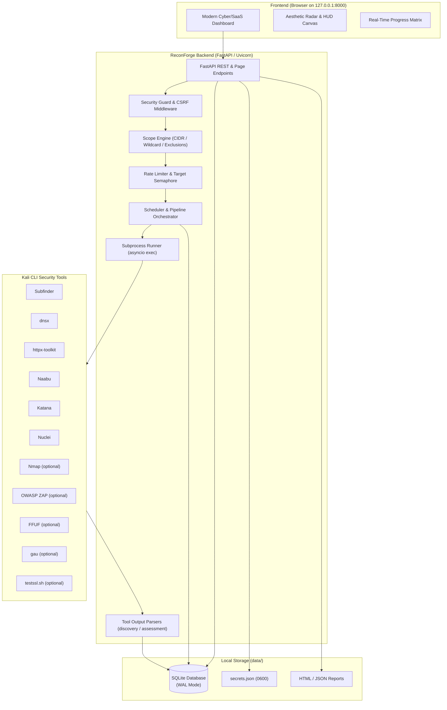
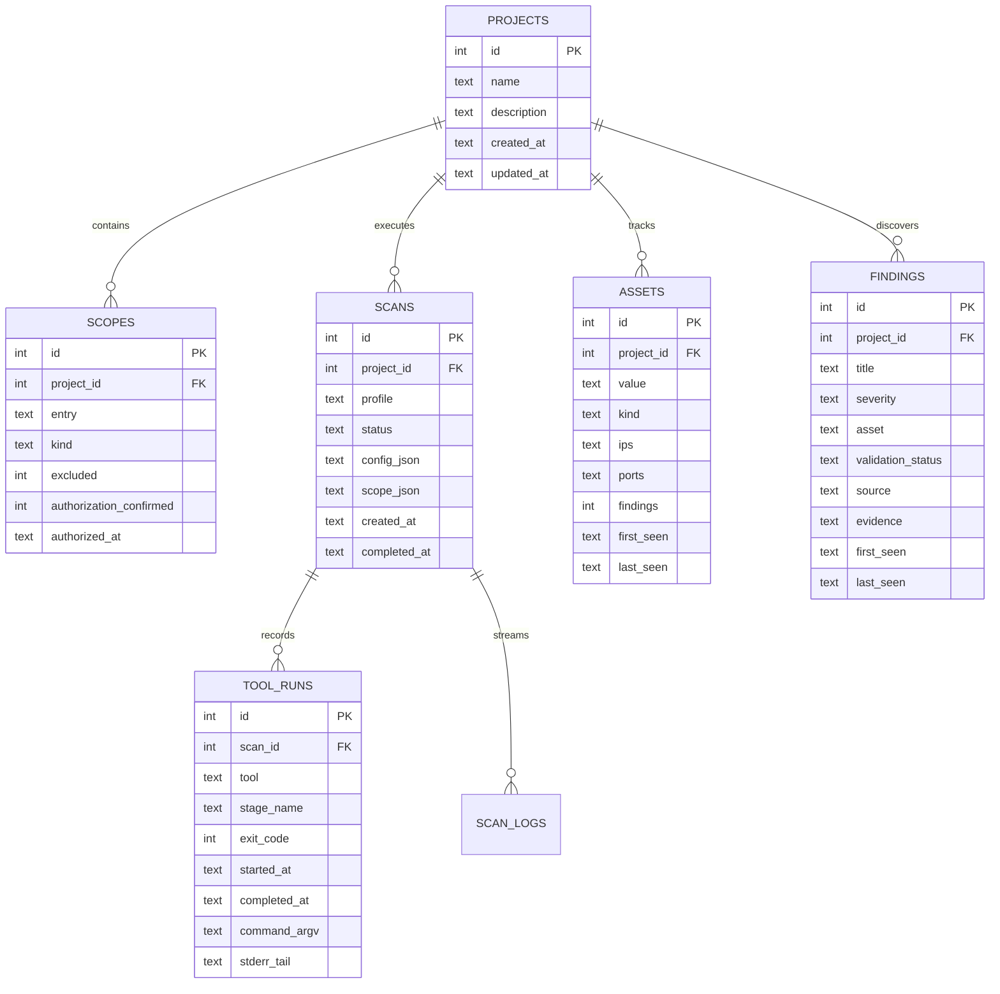

# ReconForge: Local-First Recon & Vulnerability Assessment Platform

> [!abstract] Executive Summary
> **ReconForge** is a local-first reconnaissance orchestration and attack surface management platform engineered specifically for cybersecurity practitioners, bug bounty hunters, and security researchers operating on Kali Linux. It safely controls, chains, and monitors external command-line security tools, parses structured output into SQLite, and renders an aesthetic, real-time command dashboard strictly bound to `127.0.0.1:8000`.

---

## 1. Project Philosophy & Non-Negotiable Safety Rules

ReconForge is built with safety-critical design invariants designed to eliminate unintended scanning, network flooding, and security tool exploitation:

1. **Backend-Enforced Scope Boundaries**
   - Scope is never enforced only in the client-side UI.
   - Dual-validation: Scope is validated upon entry, re-checked immediately before tool execution (`ScanRun.revalidate`), and filtered before any host, URL, or finding is saved to SQLite. Out-of-scope targets are dropped and tallied.
2. **Strict Loopback Binding & CSRF Defence**
   - The web application binds exclusively to `127.0.0.1`.
   - Host header allow-list prevents DNS rebinding attacks. State-changing requests enforce `X-ReconForge: 1` CSRF headers.
3. **Zero Shell (`shell=False`)**
   - All tools execute through `asyncio.create_subprocess_exec` with explicit argv arrays. No shell interpolation, no `os.system`, no string-concatenated commands.
4. **Conservative Scanning Defaults**
   - Rate limit defaults to **2 req/s**.
   - Exactly **1 target-touching tool** process runs at a time across the entire system via a shared semaphore to prevent accidental DoS against targets.
5. **No Automatic Intrusive or Destructive Exploitation**
   - Nuclei strictly excludes intrusive, DoS, and brute-force tags.
   - FFUF and OWASP ZAP are opt-in and restricted to the Web profile with explicit dual-confirmation.
6. **Scanner Detections are Potential Findings**
   - All scanner detections are marked `validation_status='unvalidated'` with low confidence until confirmed by a human analyst.
7. **Zero Secret Leakage**
   - API tokens reside in `data/secrets.json` (mode `0600`). Secrets are automatically redacted from scanner execution environments, logs, and exported reports.

---

## 2. Architecture & Technology Stack

ReconForge uses a lightweight, modular architecture without external cloud dependencies:



### Component Breakdown

| Layer | Technology | Purpose |
|---|---|---|
| **Web Server** | FastAPI + Uvicorn | Async HTTP server, input validation, and security middleware. |
| **Templating** | Jinja2 | Renders `shell.html` and standalone report documents. |
| **Frontend** | Vanilla JavaScript | Strict DOM construction via `h()` helper (zero `innerHTML`), CSSOM styling, SVG mathematical charts. |
| **Styling** | Vanilla CSS (`style.css`) | Design system with light/dark themes, tactile cards, phosphor radar sweep animations. |
| **Database** | SQLite3 (WAL mode) | Relational storage for projects, scopes, assets, findings, scans, tool runs, and settings. |
| **Subprocess Execution** | Python `asyncio` | Argv-based subprocess management, stdout/stderr streaming, process group cancellation. |
| **Rate Limiter** | Token Bucket Algorithm | Per-host and global request budgeting, automatic backoff on HTTP 429. |

---

## 3. Database Schema

ReconForge uses a normalized SQLite schema initialized with `CREATE TABLE IF NOT EXISTS`:



---

## 4. Supported Scanner Tool Ecosystem

ReconForge integrates 11 external tools divided into **Core** and **Optional** categories:

| Tool | Category | Pipeline Role | Kali Linux Package | Execution Details |
|---|---|---|---|---|
| **Subfinder** | Core | Passive Subdomain Enumeration | `subfinder` | Runs passive OSINT queries; contacts zero targets. |
| **dnsx** | Core | DNS Resolution & Wildcard Filtering | `dnsx` | Resolves A/AAAA records; probes CNAMEs; filters multi-level wildcards. |
| **httpx** | Core | HTTP Web Service Probing | `httpx-toolkit` | Probes HTTP/HTTPS ports (80, 443, 8080, 8443); extracts titles, status codes, techs. |
| **Naabu** | Core | Port Discovery (SYN/Connect) | `naabu` | Scans common ports using unprivileged TCP connect; respects per-host rates. |
| **Katana** | Core | Web Crawling & Endpoint Spidering | `katana` | Discovers internal application endpoints, query params, and scripts. |
| **Nuclei** | Core | Template-Based Vulnerability Detection | `nuclei` | Scans for exposure, misconfigurations, CVEs; intrusive/DoS tags excluded. |
| **Nmap** | Optional | Deep Service & OS Fingerprinting | `nmap` | Service version probing (`-sV`) on ports discovered by Naabu. |
| **OWASP ZAP** | Optional | Active Web Vulnerability Scanning | `zaproxy` | Web spidering and active baseline scanning (Web profile only). |
| **FFUF** | Optional | Content & Path Fuzzing | `ffuf` | Directory and file discovery using safe configured wordlists. |
| **gau** | Optional | Historical URL Mining | `gau` | Fetches historical URLs from Wayback Machine, AlienVault, Common Crawl. |
| **testssl.sh** | Optional | TLS/SSL Configuration Auditing | `testssl.sh` | Tests cipher suites, TLS protocol versions, and certificate validity. |

---

## 5. Feature-by-Feature Operational Guide

### Feature 1: Dashboard & Tactical Radar Command Center (`/`)
- **Purpose**: High-level posture overview and real-time surveillance monitoring.
- **Components**:
  - **Welcome Banner**: Displays active engagement status and quick-start actions (`+ Add Target`, `New Scan`).
  - **Row 1 KPI Cards**: Real-time counts for Total Targets, Discovered Subdomains & Assets, HTTP Endpoints, and Active Scanners.
  - **Row 2 Severity Cards**: Color-coded breakdown of findings (`Total`, `Critical`, `High`, `Medium`, `Low`).
  - **Donut Chart**: Mathematical SVG chart displaying finding percentages by severity.
  - **Tactical Radar HUD**: Continuous 360° phosphor beam sweep with target range rings, crosshairs, live blips, and telemetry (`Target Scope`, `Ping Rate`, `11 Tool Fleet`).
  - **Recent Activity Feed**: Real-time status of scans, newly detected assets, and completion timestamps.
  - **Quick Actions & Next Up**: One-click actions for reconnaissance, scanning, finding review, and scope maintenance.

### Feature 2: Targets & Scope Management (`/projects`)
- **Purpose**: Enforce legal boundaries, authorization records, and target lists.
- **Scope Entry Syntax**:
  - `example.com`: Authorizes strictly the apex domain `example.com`.
  - `*.example.com`: Authorizes all subdomains (`api.example.com`, `admin.example.com`), but **not** the apex domain. (Add both if both are in scope).
  - `198.51.100.14`: Authorizes single IP address.
  - `198.51.100.0/24`: Authorizes CIDR subnet.
  - **Exclusions**: Any entry flagged as an exclusion is blacklisted across all tools.
- **Resolved IP Protection**:
  - IPs resolved by in-scope hostnames are **not** port-scanned unless explicitly opted in via `allow_resolved_ips` or listed directly in scope (prevents accidental scanning of shared CDN edge nodes like Cloudflare/Akamai).

### Feature 3: Scan Execution & Pipeline Profiles (`/projects/{id}/scan`)
- **Purpose**: Configure and launch reconnaissance or assessment pipelines.
- **Profile Matrix**:

| Profile | Included Stages | Target Traffic | Requires Confirmation? |
|---|---|---|---|
| **Passive Recon** | Subfinder, gau, Shodan, urlscan | No target contact (OSINT only) | Standard Authorization |
| **Standard Recon** | Passive + dnsx, httpx, Naabu, Nmap, testssl | DNS, HTTP, and TCP port probing | Standard Authorization |
| **Vulnerability Assessment** | Standard + Nuclei | Vulnerability template scanning | **Active Testing Confirmation** |
| **Web Assessment** | Standard + Katana + Nuclei (+ optional FFUF, ZAP) | Crawling, fuzzing, active checks | **Active Testing Confirmation** |

### Feature 4: Real-Time Radar HUD & Progress Matrix (`/scans/{id}`)
- **Purpose**: Live stage-by-stage execution monitoring with 2-second background polling.
- **5-Tab Navigation**:
  1. **Pipeline Matrix**: Visual stage cards with status badges, tool names, duration, and parameter chips. Toggleable between Grid view and Linear Timeline view.
  2. **Findings & Results**: Real-time stream of newly identified potential vulnerabilities.
  3. **Tool Runs**: Deep forensic inspection of every tool invocation — exact command argv list, exit code, execution timestamps, stderr tail, and output head.
  4. **Execution Log**: Live terminal output of runner events, backoff retries, and errors.
  5. **Comparison**: Side-by-side diffing against previous scans on the same target.
- **Runtime Controls**:
  - `Pause`: Pauses pipeline safely between stages.
  - `Cancel`: Immediately terminates the active tool process group (`SIGTERM`/`SIGKILL`).
  - `Retry`: Re-executes only failed, missing-tool, or partial stages without repeating completed work.

### Feature 5: Surface Reconnaissance & Asset Inventory (`/assets`)
- **Purpose**: Centralized inventory of discovered domains, IP addresses, open ports, and web endpoints.
- **Capabilities**:
  - Filter by asset type (`All`, `Subdomains & Hosts`, `IP Addresses`).
  - Search by keyword or IP address.
  - Live HTTP status code badges (`200 OK`, `301 Redirect`, `404`).
  - First-seen and last-seen timestamps to track asset discovery over time.
  - Detail pane: View open ports, web technologies, and linked findings for any selected asset.

### Feature 6: Results & Finding Validation (`/findings`)
- **Purpose**: Triage and validate potential security vulnerabilities.
- **Validation Lifecycle**:
  - `Potential (unvalidated)`: Default state of scanner detections.
  - `Confirmed by analyst`: Verified by manual exploitation or review.
  - `False positive`: Scanner false match; excluded from final assessment stats.
  - `Accepted risk`: Known vulnerability acknowledged by program owner.
  - `Fixed`: Remediated and verified resolved in subsequent scans.
- **Severity Filters**: Instant filtering by `Critical`, `High`, `Medium`, `Low`, or `Info`.

### Feature 7: Tool Health & Diagnostics (`/tools`)
- **Purpose**: Verify the presence, path resolution, and version compatibility of all 11 security tools.
- **Functionality**:
  - Detects binaries on system `PATH` outside the virtualenv.
  - Validates tool identity regex to reject wrong binaries with matching names.
  - Displays detected version string (e.g., `Nuclei v3.3.1`, `httpx v1.6.8`).
  - One-click copy commands for Kali Linux installation (`sudo apt install <package>`).

### Feature 8: Settings, Integrations & Wordlists (`/settings`)
- **Purpose**: Manage rate budgets, third-party API credentials, and wordlists.
- **Configurations**:
  - **Rate Limiting**: Requests per second budget (default: 2), tool timeout (default: 900s), per-host budgets.
  - **Integrations**: Encrypted storage for Shodan and urlscan.io API keys in `data/secrets.json`.
  - **Wordlists**: Path restriction for FFUF wordlists (must reside inside `RECONFORGE_WORDLIST_DIRS`).

### Feature 9: Report Generation & Export
- **Purpose**: Generate audit-ready assessment reports.
- **Formats**:
  - **HTML Report** (`data/reports/scan-<id>.html`): Standalone, styled, self-contained report with zero external CDN dependencies. Protected by strict inline CSP.
  - **JSON Export** (`data/reports/scan-<id>.json`): Structured data export suitable for automation or ticket creation.

---

## 6. Developer & Testing Cheat Sheet

### Environment Setup

```bash
# Clone and enter workspace
cd /home/dora/Documents/vault/projects/reconforge

# Initialize Python virtualenv
python3 -m venv .venv
source .venv/bin/activate

# Install dependencies
pip install -r requirements-dev.txt

# Run the complete test suite (111 tests, zero network access)
python -m pytest -q

# Start ReconForge server
python -m app
# Access in browser at http://127.0.0.1:8000
```

### Adding a New Tool Adapter

To integrate a new security tool into ReconForge, follow the 5-step adapter contract:

1. **Create Adapter Class**: Create class in `app/adapters/` inheriting from `ToolAdapter`.
2. **Implement `ToolSpec`**: Provide regex identity checks to verify binary authenticity.
3. **Implement `build(ctx)`**: Construct explicit argv array; feed targets via stdin or validated flags; enforce `ctx.rate`.
4. **Implement `parse(stdout, stderr)`**: Parse output lines into `ParseResult` dataclass; handle malformed output gracefully without raising exceptions.
5. **Register in Pipeline**: Add stage definition in `app/services/pipeline.py` with stage dependencies and honest traffic notes.

---

> [!tip] Security Reminder
> ReconForge is built for authorized security assessments only. Always ensure written permission is obtained and program-specific rate limits and scope boundaries are respected.
